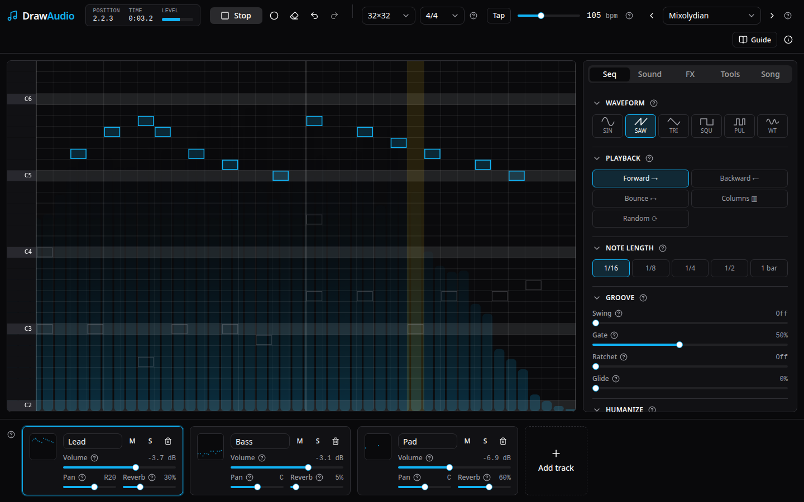
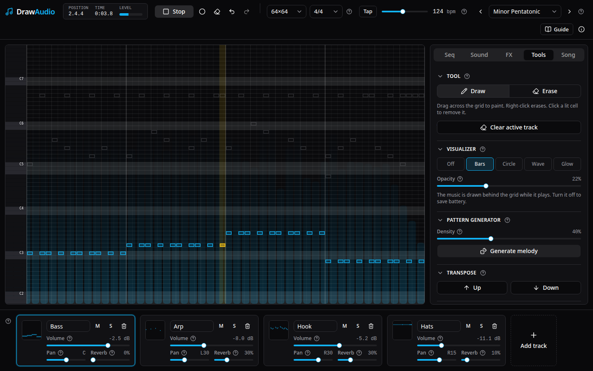
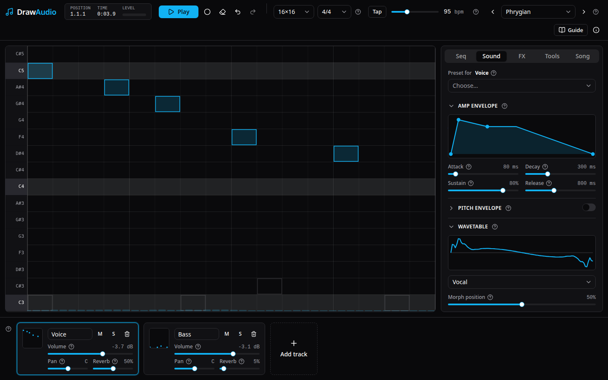
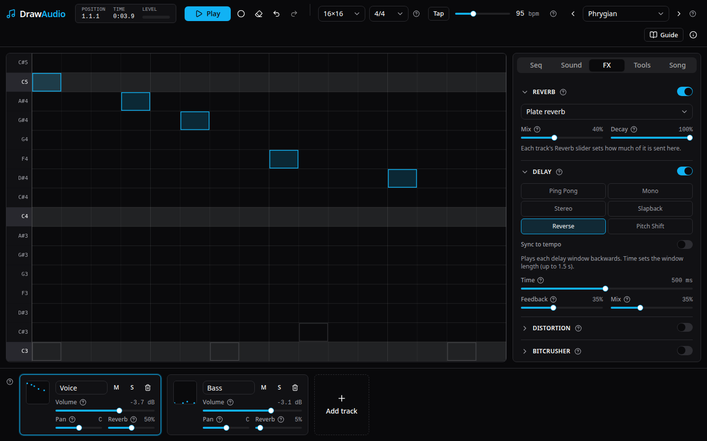
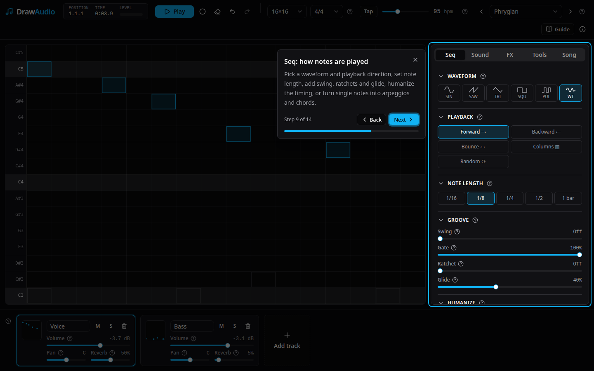
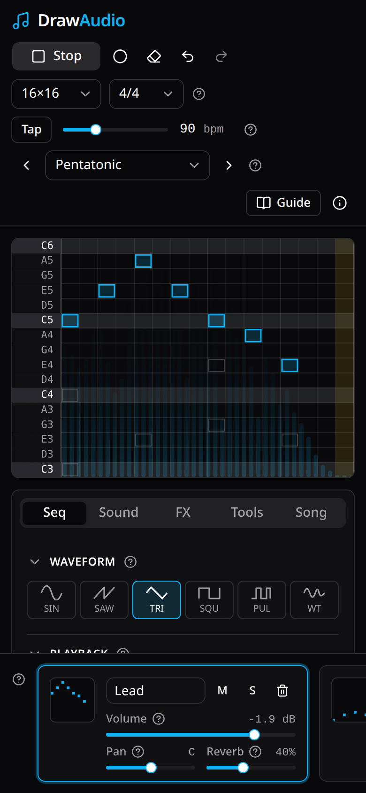
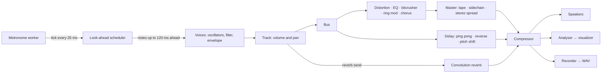

<div align="center">

# DrawAudio

**Draw notes on a grid. Hear them as music.**

A multi-track sequencer and synthesizer that runs entirely in your browser and works offline.

[](https://github.com/Zxce3/drawaudio/actions)
[](LICENSE)


[**Open the app**](https://drawaudio.zxce3.net/) · [Features](#features) · [Quick start](#quick-start) · [Shortcuts](#keyboard-shortcuts) · [How it works](#how-it-works)



</div>

> Inspired by [draw.audio](https://draw.audio/). This is an independent open-source project, with its own code, name and design.

## Features

**Draw**
- Piano-roll grid from **8×8 to 64×64**, drawn on a canvas. Click or drag to paint, right-click to erase.
- Rows are notes of the scale you pick (**18 scales**: major, minor, blues, Japanese, Dorian, Phrygian and more), so everything you draw stays in key. Note names are labelled on the left.
- Beat and bar lines, a moving playhead, ghost notes from other tracks, and full keyboard control.
- Undo and redo (100 steps), a random melody generator, and transpose.

**Play**
- Up to **8 tracks**, each with its own notes, sound, volume, pan and reverb send, plus mute and solo.
- Tempo with tap tempo, time signatures, swing, humanize, and five playback directions (forward, backward, bounce, random, skip empty columns).
- **Arpeggios** (7 modes, up to 4 octaves) and **chords** (triad, 7th, 9th, add9, sus2, sus4, power, octave, with inversions). Ratchets and glide.

**Sound design**
- Oscillators: sine, triangle, saw, square, **pulse** with width, and a morphing **wavetable** (4 tables).
- Amp envelope, pitch envelope, lowpass and highpass filters with a live response graph, filter envelope, sub oscillator, noise, unison, and FM.
- 8 presets: Clean, Pluck, Pad, Bass, Chiptune, Bell, Lead, Noise.

**Effects**
- Convolution reverb (plate, guitar cabinet, drum room) with adjustable decay.
- Delay with six modes: ping pong, mono, stereo, slapback, **reverse** and **pitch shift**, with tempo sync.
- Distortion, **bitcrusher**, chorus, stereo spread, ring mod, **sidechain** pumping, **tape** (wow, flutter, saturation, hiss), **vinyl** crackle, and a 3-band EQ.

**Songs**
- **21 example songs** on 16×16, 32×32 and 64×64 grids.
- Autosave, songs saved in your browser, and **share links** that contain the whole song in the URL.
- **MIDI import and export**, **WAV recording** (press <kbd>R</kbd>), and one-click render of a clean loop with its effect tails.

**Experience**
- **Installable and offline.** It is a PWA: once loaded, it works with no connection.
- A background **audio visualizer** (bars, circle, wave, glow) behind the grid.
- A **guided tour** (the Guide button or <kbd>H</kbd>) and a `?` explanation beside every control.
- Dark theme, responsive layout, keyboard accessible, and a reduced-motion friendly default.

## Screenshots

<table>
  <tr>
    <td width="50%"><br><sub><b>64×64 grid</b>: four bars, four tracks and the Tools tab.</sub></td>
    <td width="50%"><br><sub><b>Sound design</b>: envelope graph, wavetable preview and live filter response.</sub></td>
  </tr>
  <tr>
    <td width="50%"><br><sub><b>Effects</b>: reverb, reverse delay, bitcrusher, sidechain, tape and more.</sub></td>
    <td width="50%"><br><sub><b>Guided tour</b>: a spotlight walk through every feature.</sub></td>
  </tr>
</table>

<p align="center">
  <br>
  <sub><b>On a phone.</b> The layout stacks, and the grid uses pointer events so touch and pen work like the mouse.</sub>
</p>

## Quick start

You need [Bun](https://bun.sh/).

```bash
git clone https://github.com/Zxce3/drawaudio.git
cd drawaudio
bun install
bun run dev
```

Open the printed address (usually http://localhost:5173), click the grid to draw a few notes, and press <kbd>Space</kbd>.

### Scripts

| Command | What it does |
| --- | --- |
| `bun run dev` | Start the dev server |
| `bun run build` | Production build into `build/` (static site) |
| `bun run preview` | Serve the production build locally (this is where the service worker runs) |
| `bun run check` | Type-check Svelte and TypeScript |
| `bun test` | Run the unit tests |
| `bun run audit:seo` | Check every built page: title, description, canonical, Open Graph, h1, JSON-LD and sitemap (run `bun run build` first) |
| `bun run generate-impulse` | Regenerate the reverb impulse-response WAV files |

## Using the app

1. **Draw** notes on the grid. Higher rows are higher notes.
2. Press **Play** (or <kbd>Space</kbd>). The yellow column is the playhead.
3. Add **tracks** at the bottom, and shape each one in the **Sound** and **Seq** tabs.
4. Add space and character in **FX**.
5. Open the **Song** tab to load an example, save, share, or export.

New here? Press the **Guide** button for a step-by-step tour. Everything has a `?` icon that explains it in plain language.

### Keyboard shortcuts

Press <kbd>?</kbd> in the app for the full list.

| Keys | Action | Keys | Action |
| --- | --- | --- | --- |
| <kbd>Space</kbd> | Play / stop | <kbd>Ctrl</kbd>+<kbd>Z</kbd> | Undo |
| <kbd>R</kbd> | Record to WAV | <kbd>Ctrl</kbd>+<kbd>Shift</kbd>+<kbd>Z</kbd> | Redo |
| <kbd>-</kbd> / <kbd>=</kbd> | Tempo −1 / +1 (<kbd>Shift</kbd> for ±10) | <kbd>D</kbd> / <kbd>E</kbd> | Draw / erase tool |
| <kbd>T</kbd> | Tap tempo | <kbd>G</kbd> | Generate a melody |
| <kbd>[</kbd> / <kbd>]</kbd> | Previous / next scale | <kbd>C</kbd> | Clear the active track |
| <kbd>1</kbd>–<kbd>8</kbd> | Select a track | <kbd>Shift</kbd>+<kbd>↑</kbd>/<kbd>↓</kbd> | Transpose |
| <kbd>N</kbd> | Add a track | <kbd>M</kbd> / <kbd>S</kbd> | Mute / solo the track |
| <kbd>Ctrl</kbd>+<kbd>S</kbd> | Save the song | <kbd>Ctrl</kbd>+<kbd>E</kbd> | Export MIDI |
| <kbd>V</kbd> | Cycle the visualizer | <kbd>H</kbd> | Guided tour |

With the grid focused, use the arrow keys to move, <kbd>Enter</kbd> to toggle a note and <kbd>Delete</kbd> to erase.

### Example songs

| Grid | Songs |
| --- | --- |
| **16×16** (1 bar) | First Light · Midnight Drive · Chip Quest · Rain on Glass · Dorian Groove · Temple Bells · Neon Pulse · Lofi Window · Desert Wind · Sunrise Reggae |
| **32×32** (2 bars) | Harbor Lights · Glass Cathedral · Brass Knuckle · Paper Boats · Iron Orchard |
| **64×64** (4 bars) | Long Road Home · Static Bloom · Neon Harbor · Ember Caravan · Skyline Run · Warm Heart Riddim |

Loading an example is undoable with <kbd>Ctrl</kbd>+<kbd>Z</kbd>. Songs are defined in [`src/lib/songs.ts`](src/lib/songs.ts) using a small text notation, so adding your own is easy.

## How it works

DrawAudio has no backend. Everything runs on the Web Audio API in your browser.



- **Scheduling.** A Web Worker ticks every 25 ms (workers are not throttled in background tabs). The engine schedules every note that starts in the next 120 ms on the audio clock, so timing stays tight even when the page is busy.
- **Pitch.** Each grid row is a note of the chosen scale, with the highest note at the top. Large grids span 4 to 6 octaves, so the range always stays audible.
- **AudioWorklets.** The reverse and pitch-shift delay, the bitcrusher and the WAV recorder run in small AudioWorklet processors, loaded from Blob URLs so no extra build step is needed.
- **State.** The whole song is one reactive Svelte 5 object. The engine reads it directly, so edits are heard on the next scheduled step. History is a list of JSON snapshots.
- **Sharing.** A song is packed to bits, deflated, base64url-encoded, and stored in the URL hash. Nothing is uploaded. Data from links, files and storage is validated before use.

### Project structure

```
src/
├── lib/
│   ├── audio.ts            Audio engine: scheduler, voices, effects graph, recorder
│   ├── song.svelte.ts      Reactive song state, undo/redo, playback, recording
│   ├── types.ts            Song model, defaults, presets and validation limits
│   ├── scales.ts           Scales and the row-to-pitch mapping
│   ├── songs.ts            The 21 example songs
│   ├── storage.ts          Local saves, share links, input validation
│   ├── midi.ts · wav.ts    MIDI and WAV encoders and parsers
│   ├── wavetables.ts       Morphing wavetable data
│   ├── worklets.ts         Bitcrusher and recorder worklets
│   ├── grain-worklet.ts    Reverse and pitch-shift delay worklet
│   ├── shortcuts.ts        Keyboard shortcuts (one list drives the UI and help)
│   ├── help.ts · tour.ts   Help text and the guided tour steps
│   ├── seo.ts · examples.ts  Titles, descriptions, canonical URLs, JSON-LD and the example pages' metadata
│   ├── pwa.svelte.ts       Service worker registration, install and update state
│   └── components/         shadcn-svelte primitives and the app's own components
├── service-worker.ts       Offline caching
└── routes/                 The editor (/), the example songs (/examples/…) and the sitemap
static/                     Manifest, icons, reverb impulse responses
tests/                      Unit tests
```

## Offline and install

DrawAudio is a progressive web app. After the first visit, a service worker keeps the whole app (code, audio workers and reverb files) in the browser cache, so it opens instantly and works with no connection.

- **Install.** Use your browser's install option or the **Install** button in the top bar. On iPhone and iPad: Share → **Add to Home Screen**.
- **Updates.** When a new version is deployed, a banner offers **Reload**. Your song is autosaved, and an update never replaces code in the middle of a song.
- The service worker is disabled in `bun run dev`. Use `bun run build && bun run preview` to try it.

## SEO

The editor is a canvas app, so the site also ships real content pages that search engines can read:

- **`/`** has a descriptive title and description, one `h1`, a plain-language About section and `WebApplication` structured data.
- **`/examples/`** and **`/examples/<song>/`** give each of the 21 example songs its own page with a piano-roll preview, key facts and an *Open in DrawAudio* link (`/?song=<id>`).
- A **sitemap** is generated at build time (`/sitemap.xml`), with a canonical URL, Open Graph and Twitter tags on every page, and a 1200×630 social image.
- `bun run audit:seo` checks all of this against the built site and fails the build pipeline if a page regresses.
- Going live in Google and Bing takes a few clicks, described in [docs/search-console.md](docs/search-console.md). The site reads optional verification tokens from the `GOOGLE_SITE_VERIFICATION` and `BING_SITE_VERIFICATION` repository variables.

## Deployment

The site is built with `@sveltejs/adapter-static`, so `build/` can be hosted anywhere that serves static files. A GitHub Actions workflow ([`.github/workflows`](.github/workflows)) builds and deploys it to GitHub Pages on every push to `main`.

## Browser support

Built and tested in Chromium-based browsers. Firefox and Safari support the APIs it uses (Web Audio with AudioWorklet), but they are less tested. If a browser lacks the worklet, the app still plays, and only reverse and pitch-shift delay, the bitcrusher and recording are unavailable. Audio starts on your first click or tap, because browsers block sound until you interact with the page.

## Tech stack

[SvelteKit](https://svelte.dev/docs/kit) · [Svelte 5](https://svelte.dev) (runes) · TypeScript · [Tailwind CSS 4](https://tailwindcss.com) · [shadcn-svelte](https://shadcn-svelte.com) (bits-ui) · Web Audio API · Bun · Vite

## Contributing

Issues and pull requests are welcome.

1. Fork the repo and create a branch.
2. Run `bun run check` and `bun test` before you push.
3. Keep help text in [`src/lib/help.ts`](src/lib/help.ts) and shortcuts in [`src/lib/shortcuts.ts`](src/lib/shortcuts.ts), so the UI, tour and docs stay in sync.

Ideas that would be great additions: more example songs, more presets, additional wavetables, and translations.

## Credits

- [draw.audio](https://draw.audio/) for the inspiration.
- [svelte-audio-visualizations](https://github.com/flo-bit/svelte-audio-visualizations) (MIT) for the visualizer ideas.
- [web-audio-samples](https://github.com/GoogleChromeLabs/web-audio-samples) (Apache-2.0): the bitcrusher and WAV recorder follow its AudioWorklet patterns.
- [shadcn-svelte](https://shadcn-svelte.com) and [Lucide](https://lucide.dev) for the interface components and icons.

## MCP server for AI agents

`mcp/` contains a local [MCP](https://modelcontextprotocol.io) server so agents (Claude Code, Claude Desktop, Cursor) can compose songs, edit sounds and effects, import and export MIDI and hand you a share link that plays the result. Add it with `claude mcp add drawaudio -- bun /path/to/drawaudio/mcp/server.ts`; see [mcp/README.md](mcp/README.md).

## License

[MIT](LICENSE) © Memet Zx
